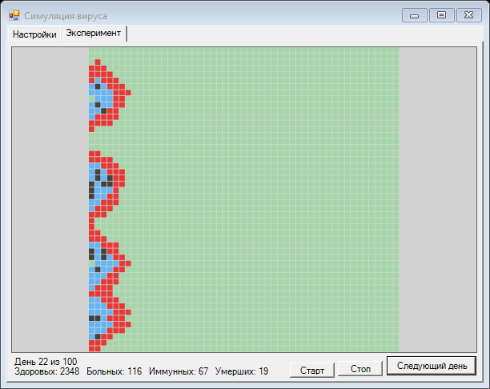
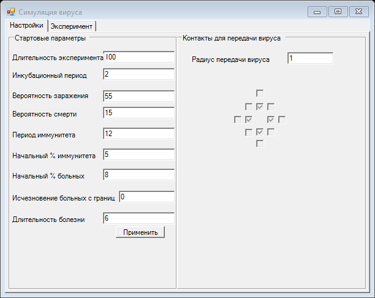

# Симуляция распространения вируса

Настольное приложение на C# (Windows Forms, .NET Framework 4.7.2): клеточный автомат, моделирующий эпидемию на поле 50×51. Каждая клетка это человек в одном из состояний: здоров, болен, иммунен, умер.





## Как это работает

- Поле замкнуто по вертикали и ограничено по горизонтали. Эпидемия начинается с левой границы.
- **Жизнь заражённого:** сначала инкубационный период (болен, но не заразен), затем дни болезни (заразен). После этого человек умирает с заданной вероятностью или получает иммунитет на заданный срок, а затем снова становится здоровым.
- **Заражение:** каждый заразный сосед заражает здорового независимо, с вероятностью «Вероятность заражения».
- **Соседи:** радиус 1 (четыре клетки по сторонам) или 2 (двенадцать клеток), галочки можно менять вручную.
- **Исчезновение больных с границ:** ежедневная вероятность, что больной в первом или последнем столбце покидает поле и снова считается здоровым.
- Эксперимент останавливается сам, когда прошло заданное число дней или больных не осталось. Над кнопками показаны день и число людей в каждом состоянии.

Цвета: зелёный здоровые, красный больные, синий иммунные, тёмно-серый умершие.

## Запуск

Откройте `CHMBP1.sln` в Visual Studio и запустите (F5) или соберите из командной строки:

```bash
msbuild CHMBP1.sln /p:Configuration=Release
```

Порядок работы: задайте параметры на вкладке «Настройки», нажмите «Применить», затем на вкладке «Эксперимент» нажмите «Старт» или «Следующий день».

## Тесты

Логика симуляции вынесена в `CHMBP1/Simulation.cs` и не зависит от Windows Forms. Тесты (xUnit) подключают этот файл напрямую:

```bash
dotnet test CHMBP1.Tests
```

Тесты проверяют стартовое состояние, скорость распространения, инкубацию, длительность болезни, иммунитет, смертность, исчезновение с границ, воспроизводимость и проверку параметров.

## Что исправлено по сравнению с первой версией

| Было | Стало |
|---|---|
| «Длительность эксперимента» читалась из поля «Начальный % иммунитета» (`textBox1`), а настоящее поле (`textBox5`) вообще не читалось | Каждый параметр читается из своего поля |
| Длительность эксперимента, инкубационный период и «исчезновение с границ» были в интерфейсе, но ни на что не влияли | Все параметры работают, эксперимент останавливается по сроку |
| Начальный иммунитет пропадал через день (счётчик дней был 0) | Он держится заданное число дней |
| Время болезни не обнулялось: после потери иммунитета повторно заразившийся выздоравливал на следующий же день | Счётчик обнуляется при каждом заражении |
| До нажатия «Применить» вирус работал с нулевыми параметрами (заражение 0 %, болезнь 0 дней) | Параметры применяются при запуске |
| Поле «Радиус» было пустым: ни одна галочка соседей не стояла, а первый шаг падал на `int.Parse("")` | По умолчанию радиус 1, шаг не падает |
| При 1 % больных в столбце из 50 клеток часто не было ни одного больного, и «ничего не происходило» | Если больные заданы, гарантированно появляется хотя бы один |
| Некорректный ввод давал «error 001» | Понятное сообщение с названием поля, проверка диапазонов 0-100 |
| На каждую клетку каждого кадра создавалась новая кисть, а старые кадры не освобождались: утечка памяти | Четыре кисти создаются один раз, кадры освобождаются |
| «Умершие» были ярко-синими, а «иммунные» бледно-синими, больные бледно-розовыми | Контрастные цвета: красный, синий, тёмно-серый |
| Подпись «Исчезновение больных с границ» перекрывалась полем ввода | Поле сдвинуто |
