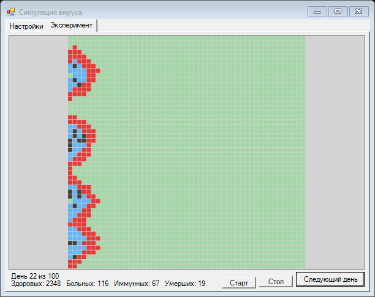
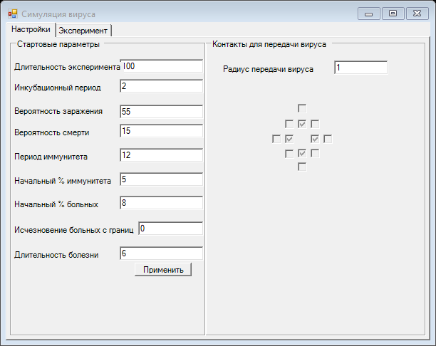

# Virus Spread Simulation

[Русская версия](README.ru.md)

A C# desktop application (Windows Forms, .NET Framework 4.7.2): a cellular automaton that models an epidemic on a 50×51 grid. Each cell is a person in one of four states: healthy, sick, immune or dead.

**Stack:** C#, .NET Framework 4.7.2, Windows Forms, xUnit.





## How it works

- The grid wraps around vertically and is bounded horizontally. The epidemic starts from the left edge.
- **Life of an infected person:** first an incubation period (sick but not contagious), then days of illness (contagious). After that the person dies with a given probability or becomes immune for a given number of days, and then becomes healthy again.
- **Infection:** each contagious neighbor infects a healthy person independently, with the "Infection probability".
- **Neighbors:** radius 1 (four cells on the sides) or 2 (twelve cells); the checkboxes can also be changed manually.
- **Sick people leaving through the edges:** a daily probability that a sick person in the first or last column leaves the grid and is counted as healthy again.
- The experiment stops by itself when the set number of days has passed or there are no sick people left. The current day and the number of people in each state are shown above the buttons.

Colors: green for healthy, red for sick, blue for immune, dark gray for dead.

## Running

Open `CHMBP1.sln` in Visual Studio and run it (F5), or build from the command line:

```bash
msbuild CHMBP1.sln /p:Configuration=Release
```

How to use: set the parameters on the «Настройки» (Settings) tab, click «Применить» (Apply), then on the «Эксперимент» (Experiment) tab click «Старт» (Start) or «Следующий день» (Next day).

## Tests

The simulation logic is extracted into `CHMBP1/Simulation.cs` and does not depend on Windows Forms. The tests (xUnit) include this file directly:

```bash
dotnet test CHMBP1.Tests
```

The tests check the initial state, spread speed, incubation, illness duration, immunity, mortality, leaving through the edges, reproducibility and parameter validation.

## What was fixed compared to the first version

| Before | After |
|---|---|
| "Experiment duration" was read from the "Initial immunity %" field (`textBox1`), and the real field (`textBox5`) was not read at all | Each parameter is read from its own field |
| Experiment duration, incubation period and "leaving through the edges" were in the UI but had no effect | All parameters work, and the experiment stops on time |
| Initial immunity disappeared after one day (its day counter was 0) | It lasts the set number of days |
| Illness time was not reset: after losing immunity, a re-infected person recovered the very next day | The counter is reset on every infection |
| Before clicking "Apply", the virus ran with zero parameters (0% infection, 0 days of illness) | Parameters are applied on start |
| The "Radius" field was empty: no neighbor checkbox was set, and the first step crashed on `int.Parse("")` | Radius 1 by default, and the step does not crash |
| With 1% sick in a column of 50 cells there was often no sick person at all, and "nothing happened" | If sick people are set, at least one is guaranteed to appear |
| Invalid input showed "error 001" | A clear message with the field name and a 0-100 range check |
| A new brush was created for every cell in every frame, and old frames were not disposed: a memory leak | Four brushes are created once, and frames are disposed |
| "Dead" was bright blue, "immune" was pale blue and "sick" was pale pink | Contrasting colors: red, blue, dark gray |
| The "Sick people leaving through the edges" label was overlapped by an input field | The field was moved |
